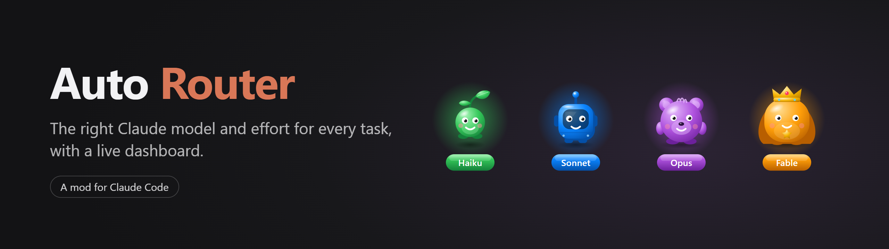
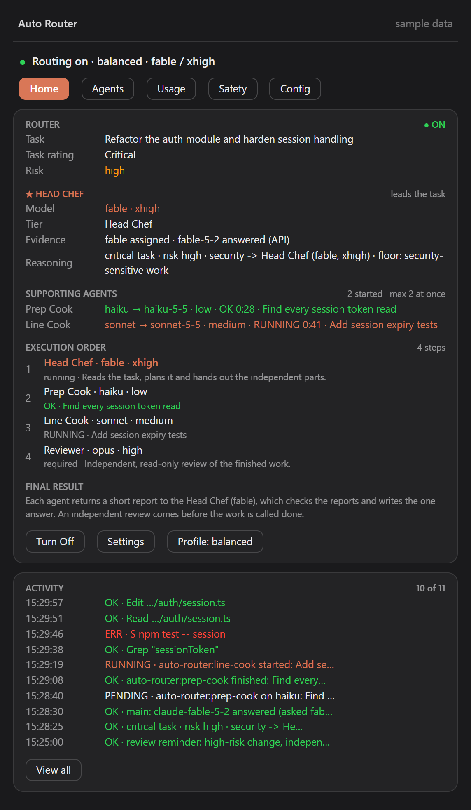
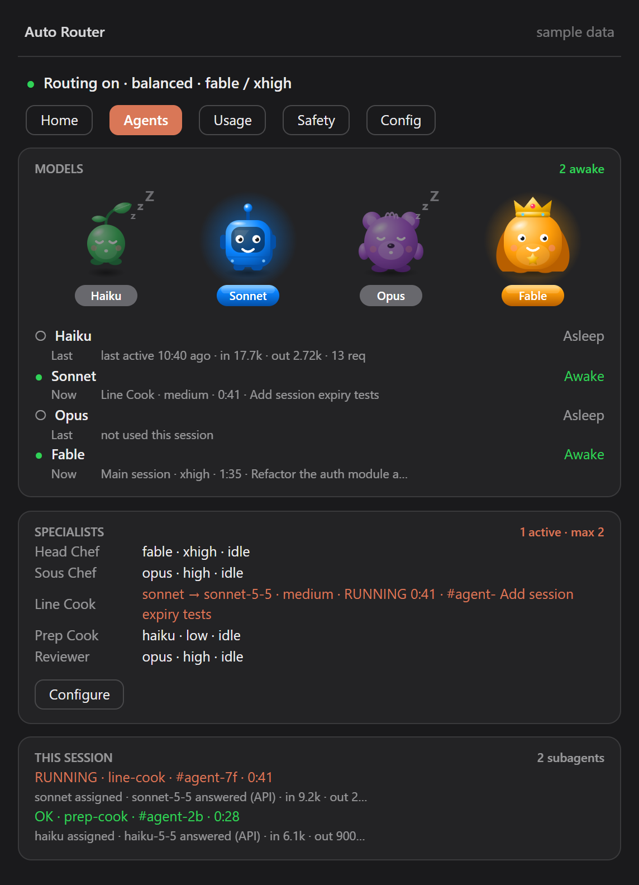
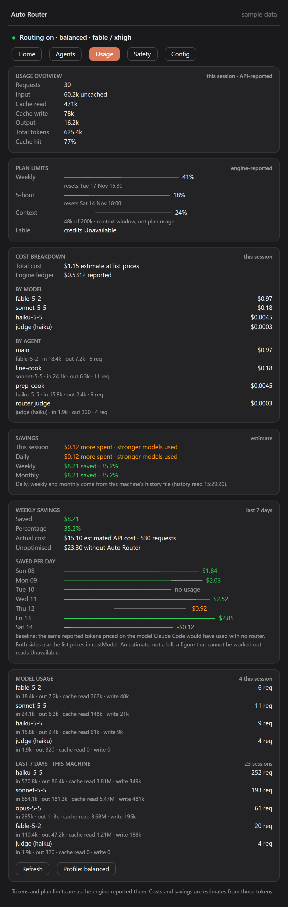
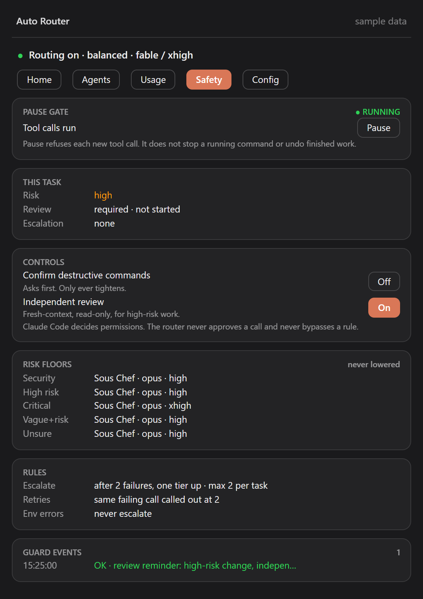
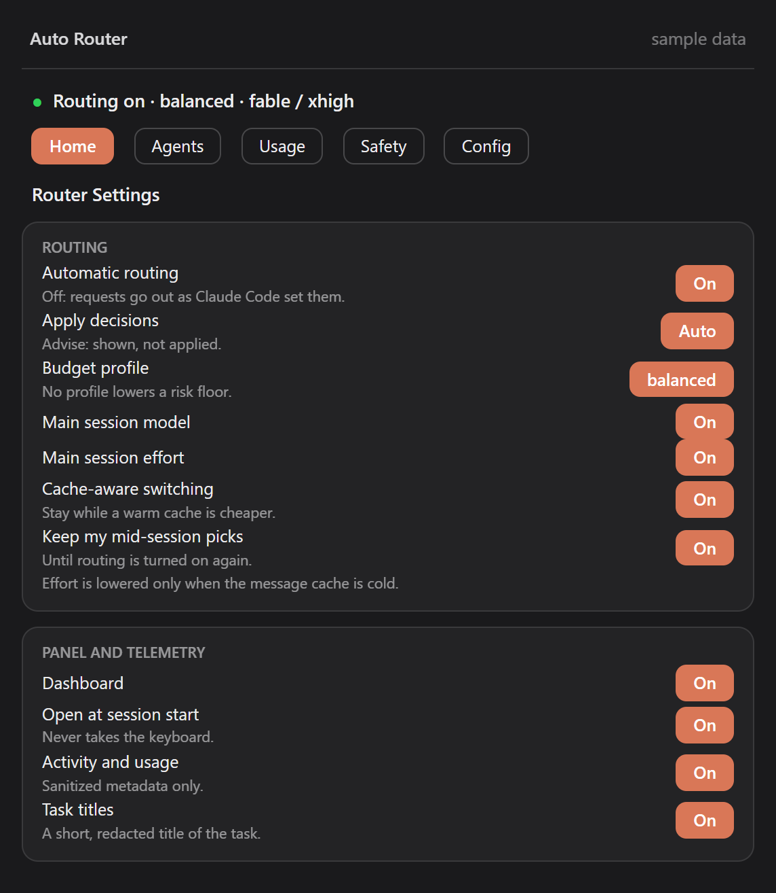
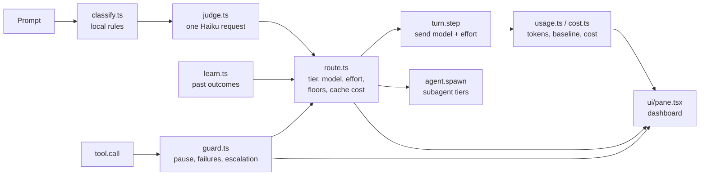

<p align="center">
  
</p>

<p align="center">
  <a href="CHANGELOG.md"></a>
  <a href="LICENSE"></a>
  
  
  
  <a href="CONTRIBUTING.md"></a>
</p>

# Auto Router

Auto Router is a mod for [Claude Code](https://claude.com/claude-code). It reads every request, works out how hard and how risky it is, and sends it to the cheapest Claude model and reasoning effort that can do the job well. Subagents are routed the same way, across four specialist tiers and an independent reviewer. A dashboard beside the conversation shows what was decided, what actually ran, and what it cost.

Quality comes first. A risk floor is never lowered by a budget setting, and a task is never moved to a cheaper model just because its prompt is short.

```
/plugin install auto-router --marketplace Velavalapallisairam/claude-code-auto-router
```

## Contents

- [Features](#features)
- [Screenshots](#screenshots)
- [Requirements](#requirements)
- [Installation](#installation)
- [Usage](#usage)
- [Configuration](#configuration)
- [How routing works](#how-routing-works)
- [Savings](#savings)
- [Safety](#safety)
- [Architecture](#architecture)
- [Troubleshooting](#troubleshooting)
- [Limits](#limits)
- [Contributing](#contributing)
- [License](#license)

## Features

| | |
| --- | --- |
| **Model and effort routing** | Each task is rated Simple, Moderate, Complex or Critical and sent to Haiku, Sonnet, Opus or Fable at a matching effort. |
| **Reads for meaning** | Local rules read risk words and structure. One short Haiku request reads what the prompt means. If that request fails, the rules stand. |
| **Quality floors** | Security-sensitive, high-impact and unclear tasks start on a strong model. No budget profile lowers a floor. |
| **Cache-aware** | Moving a conversation to another model makes that model read it uncached. The router counts that cost before it moves down. |
| **Subagent tiers** | Head Chef, Sous Chef, Line Cook and Prep Cook, plus an Independent Reviewer for high-risk work. |
| **Learns from misses** | Say "that is wrong" and the task steps up: effort first, then the model. Kinds of task that keep failing start higher next time. |
| **Dashboard** | Five tabs: the route as labelled fields, live model characters, usage with cost and savings, safety controls, configuration. |
| **Savings you can check** | Cost and savings are worked out from the tokens the API reported. A figure that cannot be worked out reads Unavailable. |
| **Pause gate** | One press refuses every new tool call until you resume. |
| **Private by design** | Activity is sanitized metadata. Never a file's content, a tool's result or a whole prompt. |

## Screenshots

These images are rendered from the dashboard's own drawing code with sample data. Inside Claude Code the pane is drawn by the app and follows your light or dark theme.

### Home

The task under way: its rating, the model that leads it, the supporting agents, the order they run in, and how the result is put together.

<p align="center"></p>

### Agents

Each model is a character that sleeps until a turn or subagent runs on it.

<p align="center"></p>

The characters are animated SVG. These are the files the dashboard draws:

<p align="center">
  
  
  
  
</p>

### Usage

Tokens, plan limits, cost by model and agent, and savings by day, week and month.

<p align="center"></p>

<details>
<summary>Safety and Settings</summary>

<p align="center">
  
  
</p>

</details>

## Requirements

| Need | Version | Why |
| --- | --- | --- |
| Claude Code | 2.1.287 or later | Mods (function hooks) |
| Claude Code | 2.1.309 or later | Routing the main conversation's model. Older engines still get effort and subagent routing. |
| Claude desktop app or VS Code extension | any current | The model characters. A terminal lists the models as text. |
| Node.js | 22.18 or later | Only for the optional static check in `tests/` |

There is nothing to build and no package to install. The mod has no dependencies.

Tested with Claude Code 2.1.321 and 2.1.325 (desktop app) and 2.1.308 (terminal).

## Installation

### 1. Install

At the prompt of a Claude Code terminal session:

```
/plugin install auto-router --marketplace Velavalapallisairam/claude-code-auto-router
```

Answer `y` to add the marketplace, then press Enter to accept the user scope.

From a shell:

```bash
claude plugin install auto-router --marketplace Velavalapallisairam/claude-code-auto-router
```

In the desktop app, where `/plugin` does not run: click **+** next to the prompt box, then **Plugins**, **Add marketplace** with `Velavalapallisairam/claude-code-auto-router`, then **Add plugin**.

### 2. Start a session

New sessions load the mod. In a session that is already open, run:

```
/reload-plugins
```

### 3. Check it

```
/auto-router status
```

The dashboard opens by itself at session start. `/auto-router` opens it again if you closed it.

### From a local folder

```bash
git clone https://github.com/Velavalapallisairam/claude-code-auto-router
claude plugin marketplace add ./claude-code-auto-router
claude plugin install auto-router@auto-router --scope user
```

The folder is read in place: edit a file, run `/reload-plugins`, and the change is live.

### Uninstall

```bash
claude plugin uninstall auto-router@auto-router
claude plugin marketplace remove auto-router
```

Your configuration and history stay in `~/.claude/auto-router`. Delete that folder if you do not want them. To turn the mod off without uninstalling: `/auto-router off`, or `claude plugin disable auto-router@auto-router`.

## Usage

Nothing to learn: send prompts as usual. The router acts on each one.

| You send | Rated | Runs on |
| --- | --- | --- |
| `fix the typo in the README heading` | Simple | Haiku, low effort |
| `add a unit test for the parseDate function` | Moderate | Sonnet, medium effort |
| `debug the intermittent deadlock in the job scheduler` | Complex | Opus, high effort |
| `refactor the authentication module and harden session handling` | Critical, security | Fable, xhigh effort, with an independent review |

To take the choice yourself, name a model or effort in the prompt, or switch model mid-session. A pick of yours is kept until you turn routing on again.

### Commands

| Command | Does |
| --- | --- |
| `/auto-router` | Open the dashboard |
| `/auto-router status` | Current route and why |
| `/auto-router usage` | Usage by model and agent |
| `/auto-router agents` | Agent assignments |
| `/auto-router config` | Effective configuration; add a request to change it |
| `/auto-router pause` / `resume` | Block or allow new tool calls |
| `/auto-router clear` | Clear the activity history |
| `/auto-router on` / `off` / `reload` | Routing on or off; re-read config.json |

All of them run locally and start no model turn.

### The dashboard

| Tab | Shows |
| --- | --- |
| **Home** | The task as labelled fields, in the order it is worked, and the ten newest activity events. Settings and the full activity list open from here. |
| **Agents** | The four models as characters, the five specialists with their models, and this session's subagents. |
| **Usage** | Usage Overview, Plan Limits, Cost Breakdown, Savings, Weekly Savings, Model Usage. |
| **Safety** | The pause gate, this task's risk and review state, risk floors, escalation rules. |
| **Config** | The config file, its effective values, and conflicts with other routing mods. |

On Home, "Head Chef" means the model that leads the current task. It is also the name of the top specialist tier.

## Configuration

The file is `~/.claude/auto-router/config.json`. It is written with defaults the first time the mod runs, so there is nothing to set up. A copy of the defaults is in [docs/config.example.json](docs/config.example.json). The file holds no credentials: the mod uses the session you are already signed in to.

Change it in any of three ways:

1. From the dashboard: Settings, Configure Agents, Safety.
2. In words: `/auto-router config switch to economical mode`, or ask Claude:
   - "Use Opus for complex frontend work."
   - "Limit parallel agents to one."
   - "Use Fable only for architecture and security."
   - "Require independent reviews for high-risk changes."
3. By hand, then `/auto-router reload`.

Every change is validated against `config.schema.json`, the previous file is copied into `backups/` (ten kept), and the new file replaces the old in one step. An invalid change is refused with the reason and changes nothing. If the file is edited by hand into something invalid, the last valid configuration stays in force and the dashboard says what is wrong.

### Main settings

| Key | Default | Meaning |
| --- | --- | --- |
| `enabled` | `true` | Routing on or off |
| `autonomous` | `true` | `false`: decisions are shown, not applied |
| `budgetMode` | `balanced` | `economical`, `balanced` or `quality`. No profile lowers a risk floor. |
| `tiers.<tier>.model` / `.fallback` | see below | The model for each specialist, and the one used while it is unavailable |
| `effortBounds` | low to max | Effort for each task rating |
| `riskFloors` | Sous Chef, high | The least a risky or unclear task may run on |
| `judge.mode` | `always` | `uncertain`: ask the judge only when the rules are unsure. `off`: rules alone. |
| `judge.subagents` | `true` | Also judge a routed subagent's task when its call named no model |
| `guardrails.maxParallelAgents` | `2` | A spawn past this is refused |
| `guardrails.confirmDestructive` | `false` | Ask before a destructive command a rule would allow |
| `costModel` | list prices | Dollars per million tokens, used for routing weights, cost and savings |
| `telemetry.historyDays` | `35` | Days of usage history kept on this machine |
| `sessions.protected` | `[]` | Session ids the router only observes |

### The kitchen

| Agent | Type | Model | Effort | For |
| --- | --- | --- | --- | --- |
| Head Chef | `auto-router:head-chef` | fable | xhigh | Complex architecture, security, exceptional reasoning |
| Sous Chef | `auto-router:sous-chef` | opus | high | Advanced development, debugging, difficult research |
| Line Cook | `auto-router:line-cook` | sonnet | medium | Standard development, testing, routine work |
| Prep Cook | `auto-router:prep-cook` | haiku | low | Simple searches, summaries, repetitive edits |
| Independent Reviewer | `auto-router:independent-reviewer` | opus | high | Fresh-context, read-only review |

## How routing works

| When | What happens |
| --- | --- |
| You send a prompt | The prompt is classified locally: complexity, risk, ambiguity, scope, area. The judge reads its meaning. A route is planned. |
| Each model request | The routed model and effort are sent. The model the API reports back is recorded as the evidence of what ran. |
| You say the answer missed | "That is wrong", "try again", "still broken": the task keeps its route and moves up a step. The first miss raises the effort alone, which keeps the prompt cache; from the second the model moves one tier up too. |
| You run a slash command | Its turn is left to the session's own model and effort. The router cannot read the skill behind a command. |
| A subagent starts | Its model is picked from its task. A spawn past the parallel limit is refused. Forks, workflow agents, resumes and teammates are never touched. |
| A tool call | It is logged as sanitized metadata. While paused it is refused before it runs. Two substantive failures move the task up a tier; environment failures do not. |

Effort follows task complexity, independently of the model: simple low, standard medium, complex high, critical xhigh, exceptional max.

**The prompt cache is counted.** The router takes the cheapest capable model freely at the first turn, moves up at once when a task needs more, and moves down only when that is cheaper with the cache counted: when the cache has gone cold, or the context is still small.

**Unsure means stronger.** Below `judge.uncertainBelow` confidence a task starts on Opus at high effort instead of trying a cheap model first.

## Savings

A cost is the tokens the API reported, priced at the list prices in `costModel` (cache writes at `cache.writeMultiplier`). A saving compares that with a baseline: the same tokens priced on the model Claude Code would have used with no router.

| Request | Baseline model |
| --- | --- |
| Main conversation | The model the engine set for that request before the router changed it |
| A subagent whose model the router changed | The model its call named, else the session's model |
| Any other subagent, fork or workflow agent | The model it ran on: no saving is claimed |
| The router's own judge request | None: it counts as cost only |

The figures are estimates, not a bill, and the dashboard says so. A stronger model than the session's shows as money spent, not hidden. Usage recorded before savings were tracked has no baseline, so it is left out of both sides. Where a model has no price, a baseline is unknown, or nothing was recorded, the figure reads Unavailable. Monthly needs `telemetry.historyDays` of 30 or more.

Not counted: a different model would not have used exactly the same tokens, and Haiku's higher price for prompts over 100K tokens.

## Safety

- Pause refuses each new tool call before it runs. It does not stop a command already running and does not undo finished work.
- The router never approves a tool call, never sets a permission mode and never edits `settings.json`. Claude Code's permission rules decide, as before.
- `guardrails.confirmDestructive` asks before a destructive or production command that a rule would allow. It only ever tightens. It reads common spellings of a command, not every way a shell can hide one, so it is an extra prompt, not a security boundary: Claude Code's permission rules are that.
- A change the model makes to a guardrail, a risk floor, the models behind the tiers, the judge or the session protection is always put to you first, whether it names the setting or asks in words.
- Activity is sanitized metadata: a file's name, the start of a command with credentials masked, an MCP tool's name.
- Everything the mod writes is under `~/.claude/auto-router`. Nothing is sent anywhere except the model requests Claude Code already makes, plus the short judge request.

## Architecture



| Path | Holds |
| --- | --- |
| `.claude-plugin/` | Plugin and marketplace manifests |
| `hooks/register.tsx` | The hooks module: every engine event the mod answers, state, files, commands |
| `hooks/engine/classify.ts` | Local rules: complexity, risk, ambiguity, scope, area |
| `hooks/engine/judge.ts` | The semantic judge and how its answer is merged, one-sidedly |
| `hooks/engine/route.ts` | Decisions: tiers, floors, cache-aware switching, escalation |
| `hooks/engine/learn.ts` | Per-kind outcome counts |
| `hooks/engine/guard.ts`, `sanitize.ts` | Failure reading, and what may be logged |
| `hooks/engine/usage.ts`, `cost.ts` | Reported usage, history, baseline, cost and savings |
| `hooks/engine/config.ts` | Defaults, schema, validation |
| `hooks/ui/pane.tsx` | The dashboard: a pure function from state to a drawing |
| `agents/` | The five specialist agents |
| `skills/routing/` | How Claude changes the configuration when asked in words |
| `types/index.d.ts` | The type contract for everything kept in state |
| `tests/` | 309 tests that fire mocked events through the real hooks. No model is called. |
| `docs/` | Images, and an example configuration |

The engine modules are pure: they take values and return values, with no access to the engine. Only `register.tsx` touches files, the clock or a model.

Data on your machine:

```
~/.claude/auto-router/
  config.json  config.schema.json  config.last-good.json
  usage-history.json  learning.json  backups/  logs/router.log
```

## Troubleshooting

| Symptom | Cause and fix |
| --- | --- |
| Nothing changes after installing | Open sessions run the old code. Run `/reload-plugins`, or start a new session. |
| The dashboard does not open | You closed it, and it stays closed until reopened: `/auto-router`. Or `sidePanel.enabled` is `false`. |
| "Routing is off" | `enabled` is `false`. `/auto-router on`. |
| "Observing only" | The session is in `sessions.protected`, or the mod is loaded from a per-session dev folder. Routing does not act there. |
| The model does not change, only the effort | The engine is older than 2.1.309, or you picked a model mid-session (shown as "Pinned by you"). Turn routing on again to hand the choice back. |
| "Config problem" in the dashboard | `config.json` is invalid. The message names the field. The last valid configuration is in use until it is fixed. |
| A conflict note about another routing mod | `model-router` or `model-selector` is also loaded and sets models too. The Config tab offers to switch it off. |
| Savings read Unavailable | No usage with a baseline yet, a model with no price in `costModel`, or history from before version 1.2.0. |
| `/auto-router` is not a command | The mod did not load. `claude plugin list` should show `auto-router` as enabled. |
| `/plugin` "is not available" | That is the desktop app's Code tab. Install from a terminal, or with the **+** menu. |

`~/.claude/auto-router/logs/router.log` records what the router decided and why.

## Limits

- Whether a session runs with Ultracode is not exposed to mods. The router treats `"ultracode": true` in settings, a workflow agent, or a session at xhigh or max as Ultracode, and then never sends less effort than the session runs at.
- A model that fails a request is put on a cooldown and its fallback serves the next request. The failed request itself is not retried.
- Lowering effort mid-session is held while the cache is warm, unless effort rides its own message (`CLAUDE_CODE_MODEL_CAPABILITIES=per_turn_effort`).
- Two prompts typed over a running turn: the later plan is never weaker than the one still waiting.
- A minimized pane shows the state, the model and effort in use and the task, with nothing to press.
- Fable usage credits are shown only if the engine reports a window for them.

## Contributing

Issues and pull requests are welcome. [CONTRIBUTING.md](CONTRIBUTING.md) has the checks to run and the rules the code follows. In short:

```bash
claude plugin validate .
claude plugin test .
node tests/verify-static.mjs
```

If Auto Router is useful to you, a star helps other people find it.

## License

[MIT](LICENSE).

Auto Router is an independent project. It is not made or endorsed by Anthropic. Claude and Claude Code are trademarks of Anthropic.
